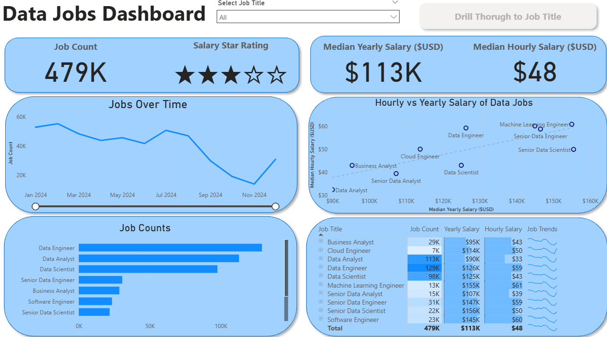
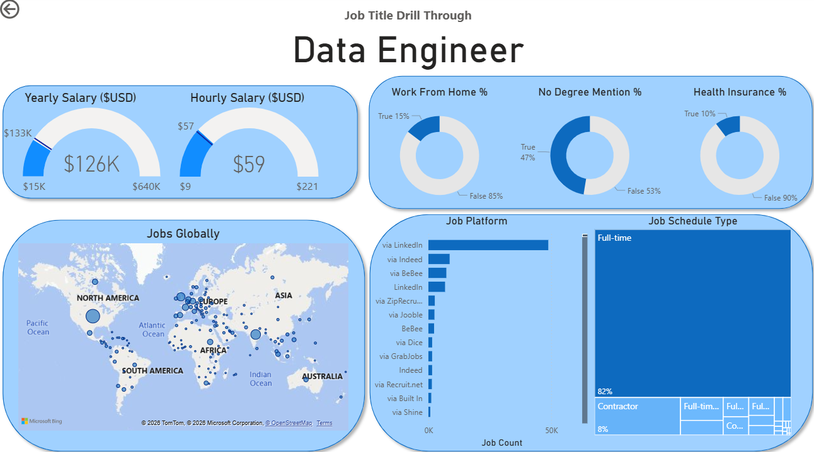

# Data Jobs Dashboard | Power BI

An interactive, two-page Power BI report exploring job demand, salary trends, and employment characteristics across data-related roles.



## Project Overview

Job seekers often need to compare multiple aspects of the data job market—demand, compensation, location, and work arrangements—across different roles. I built this dashboard as part of my Power BI learning journey to turn a dataset of 2024 data job postings into an accessible and interactive report.

The report is designed for job seekers, career changers, and anyone interested in data-related positions. It combines a high-level market overview with a dedicated **job-title drill-through page** for more detailed exploration.

## Key Metrics

The overview page displays the following metrics in its unfiltered state (rounded as shown in the dashboard):

| Metric | Value |
| --- | ---: |
| Job postings | **479K** |
| Median yearly salary | **$113K** |
| Median hourly salary | **$48** |

> **Note:** These values reflect the dashboard screenshot and may change when filters are applied. Salary figures are shown in USD and should be interpreted in the context of the underlying job-posting dataset.

## Dashboard Pages

### 1. Data Jobs Overview


The main page helps users explore:

- **Job Count:** The total number of job postings in the selected context.
- **Salary Star Rating:** A visual summary of compensation levels.
- **Median Yearly and Hourly Salary:** Key compensation benchmarks.
- **Jobs Over Time:** Monthly posting trends across 2024.
- **Hourly vs. Yearly Salary:** A comparison of median compensation by job title.
- **Job Counts:** A horizontal bar chart comparing hiring demand across roles.
- **Job Summary Matrix:** Job counts, salaries, and mini trend lines (sparklines) by role.
- **Job Title Slicer:** Interactive filtering by job title.

### 2. Job Title Drill-Through



This page provides a more detailed analysis of an individual role. The screenshot shows **Data Engineer** as an example, with:

- Median yearly salary of approximately **$126K** and median hourly salary of **$59**.
- Gauge charts displaying yearly and hourly salary levels in context.
- Donut charts for **Work From Home**, **No Degree Mention**, and **Health Insurance** indicators.
- A world map showing the geographic distribution of postings.
- Job platform comparison and a treemap of job schedule types.

The page is accessed using Power BI's **Drill-Through** functionality to preserve the selected job-title context.

## Tools and Techniques

| Area | What I Practiced |
| --- | --- |
| **Power BI Desktop** | Report development, layout, visual formatting, and interactions |
| **Power Query** | Cleaning and transforming job-posting data, managing types, and preparing salary fields |
| **Data Aggregation** | Job counts and median salary calculations |
| **Data Visualization** | Cards, line and bar charts, scatter plot, gauges, donut charts, map, treemap, and matrix |
| **Interactivity** | Slicers, drill-through navigation, and contextual filtering |
| **Dashboard Design** | Consistent visual hierarchy and compact presentation of multiple KPIs |

### Example Data Transformation

Hourly salaries can be converted into estimated annual equivalents using a standard full-time assumption:

```powerquery
if [salary_hour_avg] = null then null else [salary_hour_avg] * 2080
```

A combined salary column can then use the reported annual value where available, or the adjusted hourly value otherwise:

```powerquery
if [salary_year_avg] <> null then [salary_year_avg] else [salary_hour_adj]
```

The **2,080-hour assumption** is based on 40 hours per week over 52 weeks; it is an annualization convention rather than a guarantee of actual paid hours.

## What the Dashboard Helps Answer

- Which data job titles have the most postings?
- How does job demand change throughout the year?
- How do median hourly and annual salaries compare across roles?
- Where are jobs located, and which platforms advertise them?
- How common are remote work, degree requirements, and health insurance mentions for a selected role?

## Project Files

```text
Data_Jobs_v1/
├── README.md
└── Visualization.pbix

images/
├── Project1_img1.png
└── Project1_img2.png
```

To share the interactive report, add your own `.pbix` file to this folder and optionally link to your own published Power BI report. Screenshots alone do not contain an interactive Power BI model.

## Learning Source and Acknowledgment

This dashboard was developed while following **Luke Barousse's Power BI Data Analytics course**. The course provides the project framework; this README documents my implementation and the visuals shown above.

- [Original Project 1 reference](https://github.com/lukebarousse/PowerBI_Data_Analytics_Course/blob/main/_Project_1/README.md)

## Conclusion

This project demonstrates my ability to prepare job-market data, create clear KPIs, and design an interactive Power BI report that supports both high-level comparisons and role-specific exploration.
