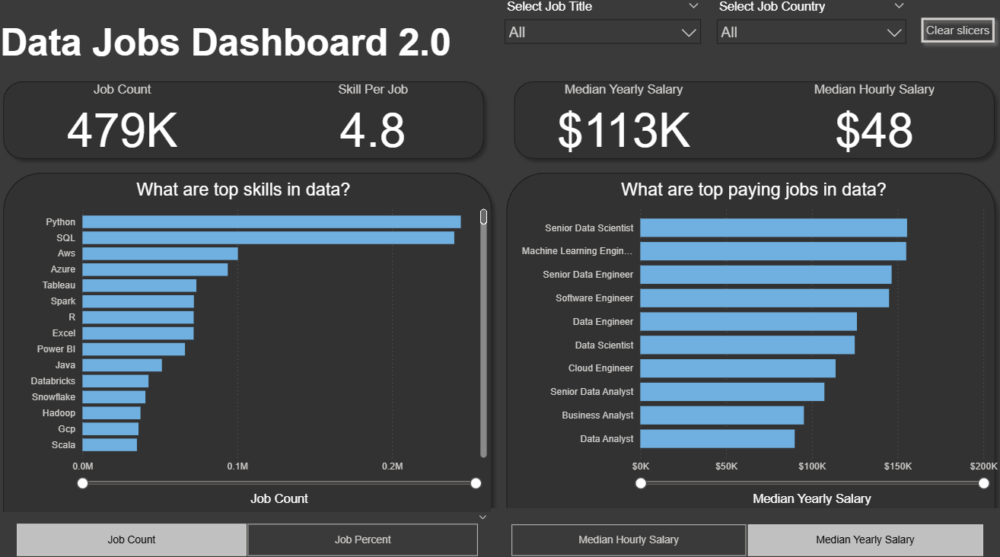

# Data Jobs Dashboard 2.0 | Power BI

An interactive Power BI dashboard designed to analyze the data job market, focusing on in-demand technical skills, salary comparisons, and job opportunities across different countries and roles.



## Project Overview

The data job market is constantly evolving, making it important for job seekers and professionals to understand which skills are most valuable, which positions offer the highest salaries, and where opportunities are available.

I developed **Data Jobs Dashboard 2.0** as part of my Power BI learning journey, building on the concepts introduced in my first dashboard project.

Using a dataset of 2024 data job postings, this project focuses on more advanced Power BI techniques, including **Star Schema data modeling, DAX calculations, and dynamic visualizations using Field Parameters**.

The dashboard provides an interactive, single-page overview that allows users to explore job demand, technical skill requirements, and salary trends.

## Skills Showcased

This project helped me develop and strengthen several important data analytics skills:

### 1. Data Transformation with Power Query

- Cleaned and prepared raw job posting data for analysis.
- Handled missing and null values.
- Adjusted column data types.
- Created calculated and conditional columns.
- Prepared and transformed tables for relational data modeling.

### 2. Data Modeling (Star Schema)

- Organized the dataset into fact and dimension tables.
- Established relationships between tables using primary and foreign keys.
- Worked with tables including `job_postings_fact`, `skills_dim`, `skills_job_dim`, `company_dim`, and `schedule_dim`.
- Used a relational data model to support analysis across job titles, salaries, and technical skills.

### 3. DAX (Data Analysis Expressions)

Applied DAX to create calculated columns and measures for deeper analysis.

Key concepts included:

- **COUNTROWS:** Counting rows in related tables.
- **RELATEDTABLE:** Retrieving related records through table relationships.
- **CALCULATE:** Modifying filter context for custom aggregations.
- **ALL:** Removing filters to calculate overall totals.
- **SUM and DIVIDE:** Calculating aggregations and percentages.

One example is the calculated column used to count the number of technical skills required for each job posting:

`skill_count = COUNTROWS(RELATEDTABLE(skills_job_dim))`

Another example is calculating the total number of skills across job postings while removing filters from the fact table:

`Grand Total Skill Count = CALCULATE(SUM(job_postings_fact[skill_count]), ALL(job_postings_fact))`

These calculations support skill-demand analysis and the comparison of individual job categories with overall market statistics.

### 4. Dynamic Visualizations with Field Parameters

- Created Field Parameters to dynamically switch between different measures.
- Implemented interactive controls for switching between **Job Count** and **Job Percent**.
- Enabled users to compare salaries using **Median Hourly Salary** and **Median Yearly Salary**.
- Improved the dashboard's flexibility without requiring multiple separate report pages.

### 5. Dashboard Design and Interactive Reporting

- Designed a compact, single-page dashboard using a dark theme.
- Created KPI cards to highlight important market statistics.
- Built horizontal bar charts for comparing skills and salaries.
- Implemented interactive slicers for job titles and countries.
- Added a **Clear Slicers** button to reset filters.
- Used data visualization principles to make insights easier to interpret.

---

## Dashboard Overview

### Data Jobs Dashboard 2.0 — Single Page


The dashboard brings together important job market insights in one interactive interface.

### Key Performance Indicators (KPIs)

The top section displays four essential metrics:

| KPI | Value |
|---|---|
| Total Job Postings | 479K |
| Average Skills Per Job | 4.8 |
| Median Yearly Salary | $113K |
| Median Hourly Salary | $48 |

These indicators provide a quick overview of hiring activity, technical skill requirements, and salary expectations.

*Note: The values above reflect the unfiltered dashboard shown in the screenshot and change dynamically when filters are applied.*

### Most In-Demand Technical Skills

The **"What are top skills in data?"** visualization highlights the technical skills most frequently requested in data-related job postings.

Some of the most prominent skills include:

- Python
- SQL
- AWS
- Azure
- Tableau
- Spark
- Excel
- Power BI

This analysis helps identify which technologies and tools are most relevant in the current dataset.

Using Field Parameters, users can switch between:

- **Job Count:** The number of job postings requiring a particular skill.
- **Job Percent:** The percentage of relevant job postings requiring that skill.

This provides two different perspectives on skill demand.

### Highest-Paying Data Jobs

The **"What are top paying jobs in data?"** visualization compares salaries across different data-related positions.

The dashboard includes roles such as:

- Senior Data Scientist
- Machine Learning Engineer
- Senior Data Engineer
- Software Engineer
- Data Engineer
- Data Scientist
- Cloud Engineer
- Senior Data Analyst
- Business Analyst
- Data Analyst

The chart helps users identify higher-paying roles and compare compensation across career paths.

Field Parameters allow users to switch between **Median Hourly Salary** and **Median Yearly Salary**, making salary analysis more flexible.

### Interactive Filtering

The dashboard includes two primary slicers:

**Select Job Title**
- Filter data based on a specific job position.
- Compare salary levels and required skills for different roles.

**Select Job Country**
- Explore job market differences across countries.
- Analyze salary and technical skill demand by location.

A **Clear Slicers** button allows users to quickly reset their selections and return to the overall dashboard view.

---

## Key Insights

Based on the dashboard's unfiltered overview:

1. **Strong Demand for Python and SQL:** These are the two most frequently requested skills in the dataset, highlighting the importance of programming and database knowledge for data-related positions.

2. **Cloud Technologies Are Important:** AWS and Azure are among the most frequently mentioned technologies, demonstrating their relevance across data roles.

3. **Specialized Roles Offer Higher Salaries:** Senior Data Scientist, Machine Learning Engineer, and Senior Data Engineer positions rank among the highest-paying roles shown in the report.

4. **Skill Requirements Vary by Position:** The overall average of 4.8 skills per job provides a benchmark for exploring differences between job categories.

5. **Interactive Analysis Supports Career Decisions:** Users can dynamically filter job titles and countries to identify skill requirements and salary patterns relevant to their interests.

These insights reflect patterns within the analyzed dataset rather than the entire global labor market.

---

## Project Files

The project files are organized within the following repository structure:

```text
Power_BI_Projects/
├── Data_Jobs_v2/
│   ├── README.md
│   └── [Power BI dashboard .pbix file]
└── images/
    └── Project2_img1.png
```

The `.pbix` file contains the Power BI report, data model, DAX calculations, and interactive visualizations.

## Learning Source and Acknowledgment

This project was developed while following **Luke Barousse's Power BI Data Analytics Course**.

The course provided the foundation for learning advanced Power BI concepts, including data modeling, DAX calculations, and dynamic reporting.

- [Original Power BI Project 2 — Luke Barousse](https://github.com/lukebarousse/PowerBI_Data_Analytics_Course/blob/main/_Project_2/README.md)

## Conclusion

**Data Jobs Dashboard 2.0** demonstrates how Power BI can be used to transform raw job posting data into an interactive analytical report.

Compared with my first dashboard, this project places greater emphasis on **data modeling, DAX, relational tables, and dynamic measure selection**.

Through this project, I strengthened my understanding of building analytical data models, creating meaningful calculations, and designing dashboards that allow users to explore job market trends and make data-driven career decisions.